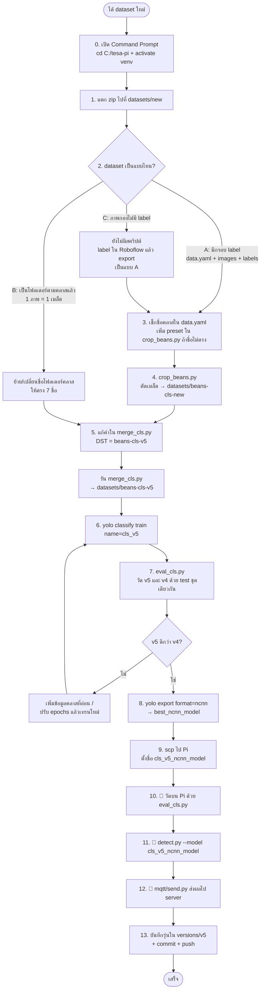

# 🔁 Flow เทรนโมเดลรุ่นใหม่ → NCNN → Raspberry Pi

คู่มือนี้ใช้เมื่อ **ได้ dataset ใหม่** แล้วอยากได้ classifier รุ่นถัดไป (เช่น v5) ไปรันบน Pi ทำตามลำดับได้เลย
(ใช้กับ classifier YOLO26n-cls ที่จำแนกเมล็ดทีละเม็ด · งาน Day 2 detection/segmentation เป็นอีก flow)

> ในคู่มือนี้แทนรุ่นใหม่ด้วย **v5** และ dataset ใหม่ด้วยชื่อ **`new`** · เปลี่ยนเป็นชื่อจริงทุกครั้ง
> 💻 = คอม Windows (Command Prompt) · 🍓 = Raspberry Pi (ผ่าน SSH)

---

## ภาพรวม



---

## 0. เปิดหน้าต่างทำงาน 💻

```bat
cd C:\tesa-pi
.venv\Scripts\activate
```

- `activate` = เข้า venv ที่มี PyTorch / Ultralytics · หน้าบรรทัดต้องขึ้น `(.venv)` ถ้าไม่ขึ้น คำสั่ง `yolo` จะหาไม่เจอ
- โฟลเดอร์ที่เกี่ยวข้อง: `datasets\` ข้อมูล · `scripts\` สคริปต์ · `runs\classify\` ผลเทรน

## 1. แตก dataset ใหม่ 💻

```bat
mkdir datasets\new
tar -xf "%USERPROFILE%\Downloads\ชื่อไฟล์.zip" -C datasets\new
dir datasets\new
```

- `tar -xf` = แตก zip · ถ้า dataset มาจาก Roboflow ให้เลือก format **YOLOv8** (หรือ YOLO26) ตอนดาวน์โหลด

## 2. ดูว่า dataset เป็นแบบไหน

| แบบ | หน้าตา | ไปขั้น |
|---|---|---|
| **A** มีกรอบ label | มี `data.yaml` และ `train\images`, `train\labels` (+ `valid`, `test`) | 3 → 4 → 5 |
| **B** แยกโฟลเดอร์ตามคลาสแล้ว | `train\good\*.jpg`, `train\shell\*.jpg` ... ภาพละ 1 เมล็ด | 5 (ข้าม 3–4) |
| **C** ภาพกองไม่มี label | มีแต่ภาพ ไม่มี `labels` | ⚠️ ยังไม่มีสคริปต์ตัดเมล็ดอัตโนมัติ → label ใน Roboflow แล้ว export เป็นแบบ A |

แบบ B: ชื่อโฟลเดอร์คลาสต้องเป็น 7 ชื่อนี้เท่านั้น `good` `shell` `full_black` `husk` `broken` `parchment` `immature` · ถ้าชื่อไม่ตรงให้เปลี่ยนชื่อโฟลเดอร์ก่อน

## 3. เช็กชื่อคลาส (แบบ A) 💻

```bat
type datasets\new\data.yaml
```

ดูบรรทัด `names:` แล้วเทียบกับ 7 คลาสของเรา ถ้าชื่อไม่ตรง เพิ่ม preset ใหม่ใน `scripts\crop_beans.py` ส่วน `PRESETS` เช่น

```python
PRESETS = {
    "robusta": {...},
    "nia": {...},
    "new": {      # ชื่อใน dataset ใหม่ → ชื่อของเรา · คลาสที่ไม่ใส่จะถูกข้าม
        "Good": "good", "Black": "full_black", "Broken": "broken", "Husk": "husk",
        "Shell": "shell", "Parchment": "parchment", "Immature": "immature",
    },
}
```

- ซ้าย = ชื่อใน `data.yaml` (ตัวพิมพ์เล็ก/ใหญ่ต้องตรง) · ขวา = ชื่อของเรา
- คลาสที่ไม่เกี่ยว (เช่น foreign, sour) ไม่ต้องใส่ สคริปต์จะข้ามเอง

## 4. ตัดเมล็ดเป็นภาพเดี่ยว (แบบ A) 💻

```bat
python scripts\crop_beans.py --preset new --src datasets/new --dst datasets/beans-cls-new --prefix new
```

| ตัวเลือก | ความหมาย |
|---|---|
| `--preset` | ตารางแปลงชื่อคลาสจากขั้น 3 |
| `--src` / `--dst` | โฟลเดอร์ต้นทาง / ปลายทาง |
| `--prefix` | คำนำหน้าชื่อไฟล์ (`new_...jpg`) กันชื่อชนตอนรวม และใช้แยกวัดผลทีหลัง |

**เช็กผล:** สคริปต์พิมพ์ตารางจำนวนเมล็ดต่อคลาส × train/val/test · ถ้าคลาสไหนเป็น 0 แปลว่าชื่อใน preset ไม่ตรง → กลับไปขั้น 3

## 5. รวม dataset เป็นชุดใหม่ 💻

แก้ค่าด้านบนของ `scripts\merge_cls.py`:

```python
KEEP_SPLIT = [Path("datasets/beans-cls")]                                  # ใช้การแบ่ง train/val/test เดิม
RESPLIT = [Path("datasets/beans-cls-nia"), Path("datasets/beans-cls-cfe"), Path("datasets/beans-cls-new")]  # เทรวมแล้วแบ่งใหม่ 80/10/10
DST = Path("datasets/beans-cls-v5")                                        # ⚠️ ชื่อใหม่ทุกครั้ง
```

- ใส่ชุดใหม่ใน **`RESPLIT`** ถ้า: ไม่มี valid/test, มีน้อย, หรือมาจาก Roboflow (ภาพเดียวกันมักมีหลายสำเนาคนละ split)
- ใส่ใน **`KEEP_SPLIT`** ถ้า: ผู้จัดแบ่ง train/val/test มาให้แล้วและต้องใช้ตามนั้น
- ⚠️ `merge_cls.py` **ลบโฟลเดอร์ `DST` ทิ้งก่อนสร้างใหม่** ห้ามตั้ง `DST` เป็น `beans-cls-v4` ไม่งั้นชุดของ v4 หายและจะเทียบผลไม่ได้

```bat
python scripts\merge_cls.py
```

**เช็กผล:** ตารางสรุปท้ายสุด `[รวม → datasets\beans-cls-v5]` ต้องมีครบ 7 คลาส และ val/test ไม่เป็น 0

## 6. เทรน 💻

```bat
yolo classify train model=yolo26n-cls.pt data=datasets/beans-cls-v5 epochs=60 imgsz=320 device=0 name=cls_v5
```

| ตัวเลือก | ความหมาย |
|---|---|
| `classify` | งานจำแนก: ภาพละ 1 เมล็ด → 1 คลาส |
| `model=yolo26n-cls.pt` | โมเดลตั้งต้นขนาดเล็กสุด (มีใน `C:\tesa-pi` แล้ว) |
| `data=` | ชุดที่รวมจากขั้น 5 |
| `epochs=60` | จำนวนรอบ · v4 ใช้ 60 (~84 นาทีบน RTX 4060) |
| `imgsz=320` | ขนาดภาพ · **ต้องใช้เลขเดียวกันตอน export และบน Pi** |
| `device=0` | ใช้การ์ดจอ |
| `name=cls_v5` | ชื่อโฟลเดอร์ผล → `runs\classify\cls_v5\` |

- ถ้ามี `cls_v5` อยู่แล้ว Ultralytics จะตั้งชื่อใหม่เป็น `cls_v52` เอง → ดูชื่อโฟลเดอร์จริงที่บรรทัดท้ายตอนเทรนเสร็จ
- ไฟล์ที่ได้: `weights\best.pt` (ตัวที่ใช้) · `confusion_matrix_normalized.png` · `results.png`

## 7. วัดผลและเทียบกับรุ่นเดิม 💻

วัดทั้ง v5 และ v4 ด้วย **test ชุดเดียวกัน** (ของ v5) ถึงจะเทียบกันได้

```bat
python scripts\eval_cls.py --model runs\classify\cls_v5\weights\best.pt --data datasets\beans-cls-v5\test
python scripts\eval_cls.py --model runs\classify\cls_v4\weights\best.pt --data datasets\beans-cls-v5\test
```

แยกดูเฉพาะข้อมูลชุดใหม่ (ไฟล์ขึ้นต้น `new_`):

```bat
python scripts\eval_cls.py --model runs\classify\cls_v5\weights\best.pt --data datasets\beans-cls-v5\test --include new_
```

- `eval_cls.py` พิมพ์ความแม่นต่อคลาส + overall + คู่ที่ทายผิดบ่อยสุด
- **ดีกว่า** → ไปขั้น 8 · **ไม่ดีกว่า** → เพิ่มภาพของคลาสที่อ่อน หรือลองปรับ epochs แล้วกลับไปขั้น 6 (ใช้ `name=cls_v5b` ฯลฯ)

## 8. แปลงเป็น NCNN 💻

```bat
yolo export model=runs\classify\cls_v5\weights\best.pt format=ncnn imgsz=320
```

- NCNN = รูปแบบโมเดลที่รันบน CPU ของ Pi ได้เร็ว ไม่ต้องใช้ PyTorch
- ได้โฟลเดอร์ `runs\classify\cls_v5\weights\best_ncnn_model\` · `imgsz` ต้องตรงกับตอนเทรน

## 9. ส่งไป Pi 💻

```bat
scp -r runs\classify\cls_v5\weights\best_ncnn_model admin@tesa-pi.local:~/tesa/cls_v5_ncnn_model
scp -r datasets\beans-cls-v5\test admin@tesa-pi.local:~/tesa/beans-test-v5
scp scripts\eval_cls.py admin@tesa-pi.local:~/tesa/
```

- `scp` = คัดลอกไฟล์ไป Pi ผ่าน SSH · รันในหน้าต่างคอม ไม่ใช่หน้าต่าง SSH
- ⚠️ ชื่อปลายทาง **ต้องลงท้าย `_ncnn_model`** ไม่งั้น Ultralytics ไม่รู้จัก (`is not a supported model format`)
- บรรทัด 2–3 ส่งภาพ test และสคริปต์วัดผลไปวัดบน Pi (ทำครั้งเดียวต่อรุ่น)

## 10. วัดบน Pi 🍓

```bash
ssh admin@tesa-pi.local
tmux attach -t tesa          # ถ้าขึ้น no sessions: tmux new -s tesa
cd ~/tesa
source .venv/bin/activate
python eval_cls.py --model cls_v5_ncnn_model --data beans-test-v5
```

- ความแม่นควรใกล้กับขั้น 7 บนคอม (NCNN ไม่ทำให้แม่นลด) · ดู `time per bean` = ความเร็วต่อเม็ดบน Pi

## 11. ลองตรวจจับทั้งสายบน Pi 🍓

```bash
python detector/detect.py full-test/*.jpg --model cls_v5_ncnn_model --lot TEST-V4
```

- `--model` = เลือกโมเดลรอบนี้โดยไม่ต้องแก้โค้ด · ผลอยู่ที่ `results/TEST-V4.json` + `results/*_annotated.jpg`
- ใช้ v5 เป็นตัวหลักถาวร: แก้ค่าเริ่มต้นใน `detect.py`

```bash
sed -i 's/cls_v4_ncnn_model/cls_v5_ncnn_model/' detector/detect.py
grep -n '^MODEL' detector/detect.py
```

(`sed -i` = แทนข้อความในไฟล์ · `grep` เช็กว่าเปลี่ยนแล้ว · แก้ไฟล์เดียวกันใน repo บนคอมด้วย ขั้น 13)

## 12. ส่งผลไป server 🍓

```bash
python mqtt/send.py results/TEST-V4.json
```

ขึ้น `✅ ส่งแล้ว → ...` = สำเร็จ · ต้องมี `mqtt/mqtt.yaml` บน Pi (มีอยู่แล้ว)

## 13. บันทึกรุ่นลง GitHub 💻

```bat
cd C:\tesa-bean-grader
mkdir versions\v5
copy C:\tesa-pi\runs\classify\cls_v5\weights\best.pt versions\v5\cls_v5.pt
copy C:\tesa-pi\runs\classify\cls_v5\args.yaml versions\v5\
copy C:\tesa-pi\runs\classify\cls_v5\results.csv versions\v5\
copy C:\tesa-pi\runs\classify\cls_v5\results.png versions\v5\
copy C:\tesa-pi\runs\classify\cls_v5\confusion_matrix*.png versions\v5\
```

1. เขียน `versions\v5\README.md` ตามแบบ `versions\v4\README.md` (ข้อมูลที่ใช้, คำสั่ง, ผลขั้น 7 และ 10, ข้อสังเกต)
2. เพิ่มแถว v5 ในตาราง `versions\README.md` และย้าย ✅ มาที่ v5
3. ถ้าแก้ `crop_beans.py` / `merge_cls.py` บนคอม คัดลอกไปไว้ใน `scripts\` ของ repo ด้วย
4. ถ้าเปลี่ยนตัวหลัก แก้ `MODEL` ใน `detector\detect.py` ของ repo

```bat
git add -A
git commit -m "Add v5 classifier"
git push
git tag -a v5 -m "v5: <สรุปสั้น ๆ>"
git push --tags
```

---

## สรุปชื่อไฟล์/โฟลเดอร์ต่อรุ่น

| อะไร | v4 (ปัจจุบัน) | v5 (ถัดไป) |
|---|---|---|
| dataset รวม | `datasets\beans-cls-v4` | `datasets\beans-cls-v5` |
| ผลเทรน | `runs\classify\cls_v4\` | `runs\classify\cls_v5\` |
| โมเดล .pt | `weights\best.pt` | `weights\best.pt` |
| NCNN บนคอม | `weights\best_ncnn_model\` | `weights\best_ncnn_model\` |
| NCNN บน Pi | `~/tesa/cls_v4_ncnn_model` | `~/tesa/cls_v5_ncnn_model` |
| ใน repo | `versions/v4/` | `versions/v5/` |

## แก้ปัญหาที่พบบ่อย

| อาการ | วิธีแก้ |
|---|---|
| `'yolo' is not recognized` | ยังไม่ได้ activate venv (ขั้น 0) |
| `crop_beans.py` ได้ 0 เม็ดบางคลาส | ชื่อใน preset ไม่ตรง `data.yaml` (ตัวพิมพ์เล็ก/ใหญ่, ขีด) |
| `KeyError` ตอน `crop_beans.py --preset ...` | ยังไม่ได้เพิ่ม preset ชื่อนั้นใน `PRESETS` |
| `merge_cls.py` ไม่เจอภาพ | path ใน `KEEP_SPLIT` / `RESPLIT` ผิด หรือโครงสร้างไม่ใช่ `<split>\<คลาส>\*.jpg` |
| เทรนช้ามาก / ใช้ CPU | ลืม `device=0` หรือ PyTorch ไม่เห็น GPU → `python -c "import torch; print(torch.cuda.is_available())"` |
| เทรนแล้ว `CUDA out of memory` | ใส่ `batch=8` เพิ่มในคำสั่งเทรน |
| export โหลด `pnnx` ค้าง | `Ctrl + C` → `pip install pnnx` → export ใหม่ |
| Pi: `is not a supported model format` | ชื่อโฟลเดอร์โมเดลบน Pi ต้องลงท้าย `_ncnn_model` |
| Pi: ความแม่นต่างจากคอมมาก | `imgsz` ตอน export / บน Pi ไม่ตรงกับตอนเทรน |
| `scp: No such file or directory` | รันผิดเครื่อง (ต้องรันบนคอม) หรือ path ผิด |
